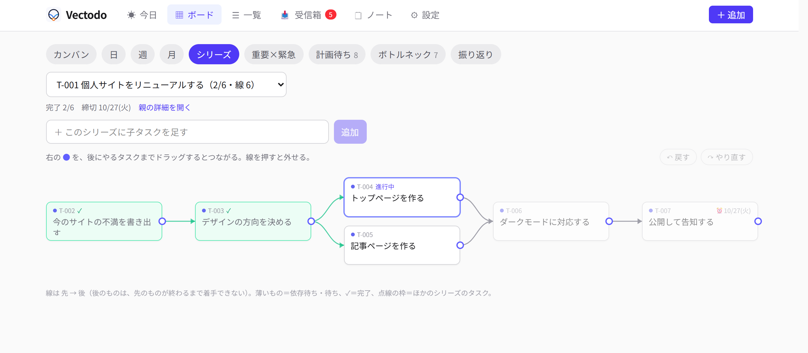
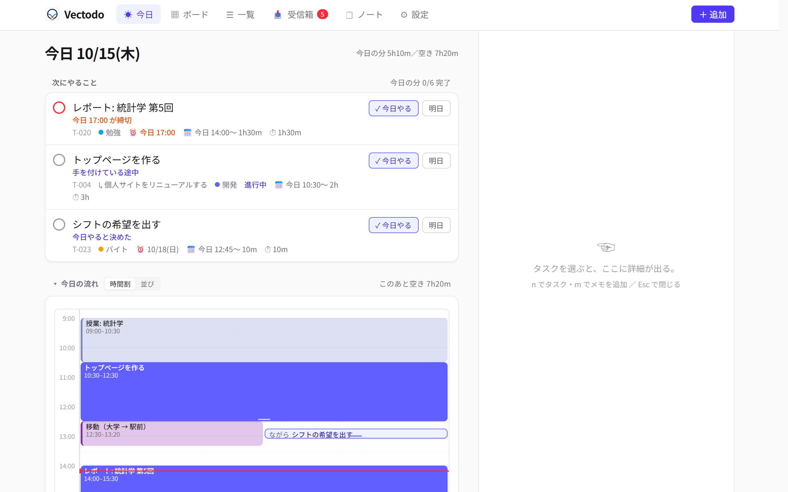
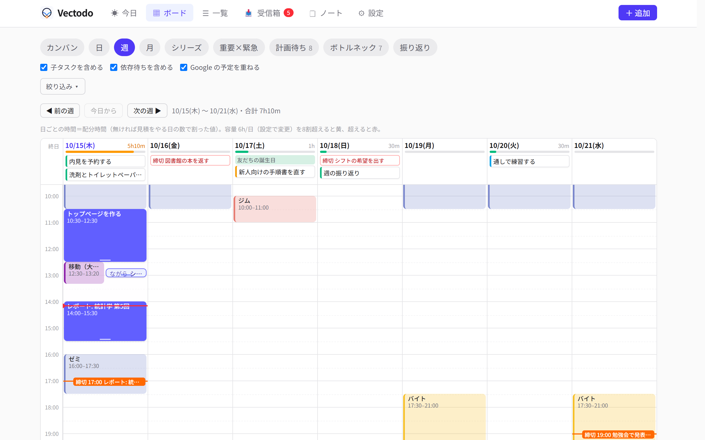
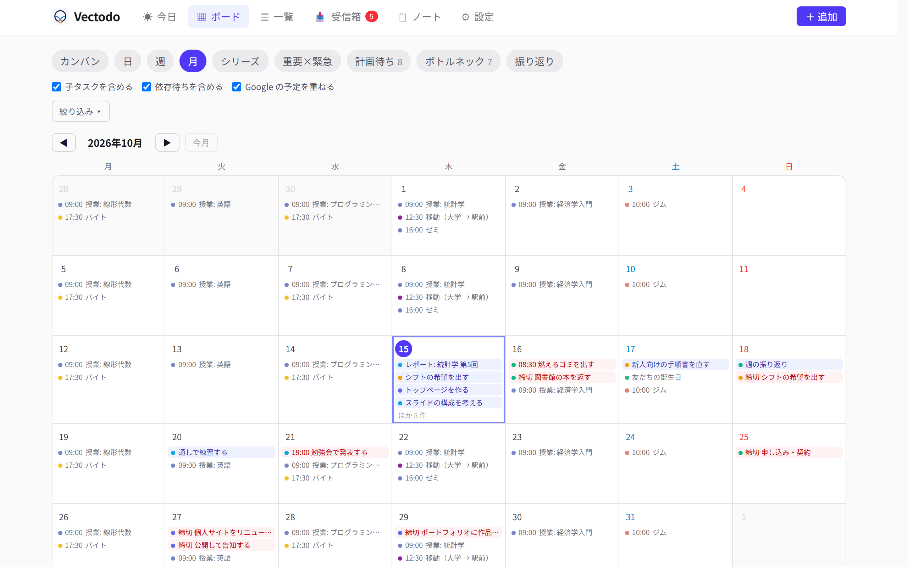
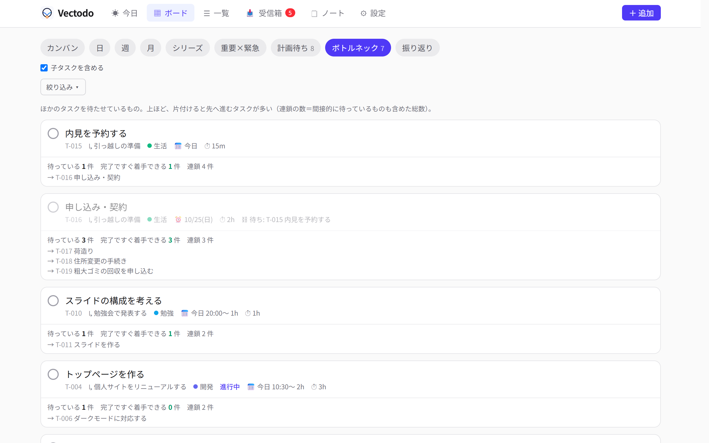
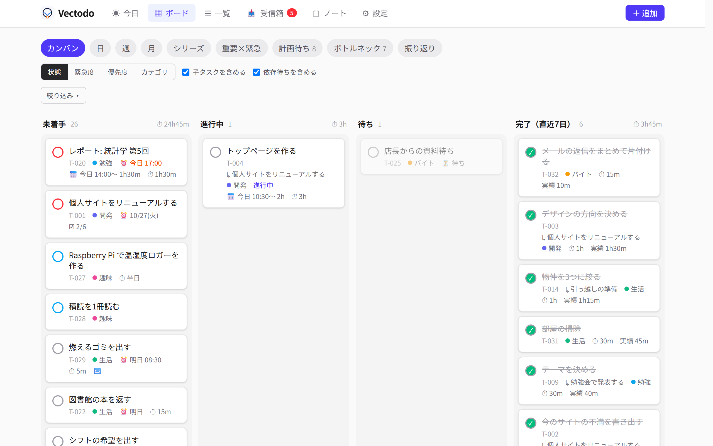
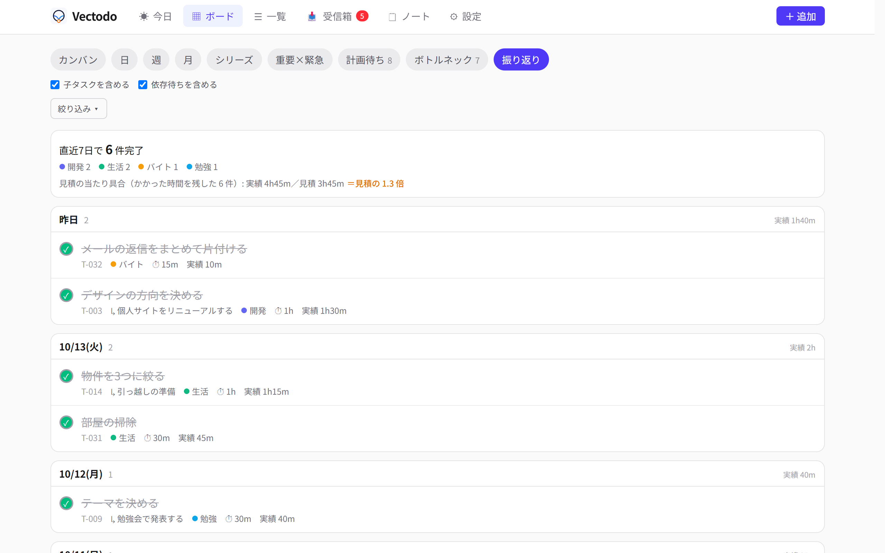
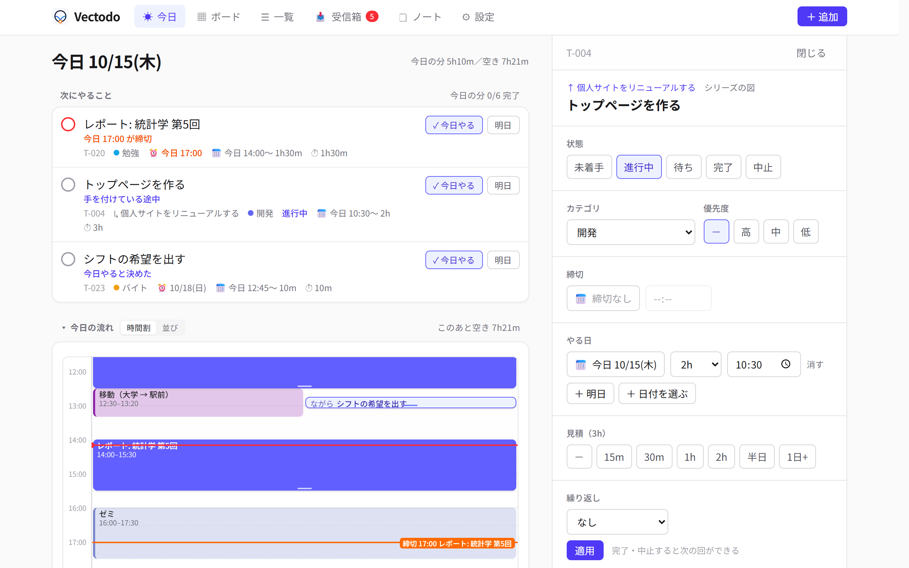

## はじめに
自分で使うタスク管理アプリ「Vectodo」を作りました．

タスク同士の「これが終わらないとあれに手を付けられない」という依存関係を登録できるのが一番の特徴です．スマホ（ホーム画面に追加して使う Web アプリ）と PC のブラウザから使えて，Claude Code などの AI からも MCP 経由で読み書きできます．

普段組み込み開発や研究をするうえで，タスク同士が複雑な依存関係をもって現れることがよくあり，それをうまく管理できるツールを探していました．既存のツールにも似たような機能があるものはありますが，どれもしっくり来てませんでした．

さらにAIで様々な作業を行うようになって，タスク管理ツールとAIとの連携が必須になってきました．今まではPC内にタスク管理用のディレクトリを作ってそこでClaude Codeを動かし，管理してもらっていましたが，AIが読みやすいCSVやMarkdownなどの形式で保存していると，人間が読みづらかったり書き込みづらかったりしていました．

その2つの悩みごとを同時に解決するために，自分の環境，使い方にあったタスク管理アプリを作ることにしました．計画自体は昨年の12月からあって途中までは作っていたのですが，色々こだわって作っていたらかなりの時間がかかってしまい，途中でバイブコーディングに飽きて放置してしまっていました．

やっと実用段階までこぎつけたので紹介したいと思います．

## こだわりポイント
### 依存関係の可視化

タスクには「先にやるもの → 後にやるもの」の線を引けます．先のものが終わっていないタスクは薄く表示され，「待ち」の理由として「待ち: T-015 内見を予約する」のように出ます．親タスクの下の子タスクどうしの線は，ボードの「シリーズ」で図として見られます．

線を引くのは，タスクの横の ● を後にやるタスクまでドラッグするだけです（スマホでも指でなぞれます）．線を押せば外せます．図の上の欄からは，そのシリーズの子タスクをタイトルだけでどんどん足せるので，「工程を書き出す → ドラッグで順番をつなぐ」がこの画面だけで済みます．直感的な操作で，きれいな見た目になるようにこだわりました．



線を持っているので，「どれを片付けると，いちばん多くのタスクが先へ進むか」も数えられます（後述のボトルネック）．

### 「実行日」と「締切」を分ける
既存のタスク管理ツールではタスクの「実行日」と「締切」を別で管理できないものが多いです．Vectodoではタスク1つに対して，締切とは別に実行日を複数設定することができ，タスクを「いつやるか」簡単に管理することができます．

GoogleカレンダーのようなUIで空いてる時間を選択し，簡単にタスクの実行日を決めることができます．（移動中にタスクを実行などのケースを想定し，予定にタスクを重ねることも可能です）もちろんGoogleカレンダーと連携し，カレンダーに登録されている予定を表示したり，登録したタスクをカレンダーに書き込むこともできます．また，タスクのカテゴリごとに登録するカレンダーを変えることもできます．

### 「見積もり時間」と「実績」による工数管理
タスクには見積もり時間を登録することができます．またタスクを完了した際に実際に何時間かかったかを記録することができます．これらのデータが蓄積されることによって，AIに空いている時間を有効活用してタスクを配分してもらうような使い方ができます．仕事等で工数管理をしたい場合にも便利です．

### タスクを簡単に登録する
色々な機能を詰め込みすぎて，1つのタスクに設定できるパラメータがものすごく多いです．これを全て登録しないとタスクが登録できないようだと続かないので，タイトルを入れるだけでタスクを作成できるようにしました．実行日やカテゴリは1タップで簡単に登録することができます．

### メモ・ノート機能
タスクとは別にクイックメモの機能をつけました．タスクにするほどではないけど外出先でメモしたいことがあったときなどに使う想定です．メモを元にあとからタスク登録するような機能もあります．

### データを外部に置かない
サーバーは自宅の PC（WSL2）で常駐させていて，データは SQLite のファイル1つです．スマホからは Tailscale（自分の端末だけが入れる VPN）越しに開きます．外に出るのは，Googleカレンダーへの書き出しとMCPを使った時にAnthropicに送られるだけです．

## 機能の紹介
自分が欲しいと思った機能を全て詰め込んだので，たくさん機能がありますが過剰ではないと思っています．ここでは代表的な機能を紹介します．

### 今日

いちばん上に「次にやること」3件，その下に「今日の流れ」（時間割／時刻順の並び），さらに「その次に」「近いうちに」「待っているもの」が続きます．時間割は「並び」に切り替えると，いま以降の予定・タスク・空き時間が1本のリストになります．

### ボード

PC で全体を見渡すための画面です．9つの見方があります．

| 見方 | 内容 |
| --- | --- |
| カンバン | 状態／緊急度／優先度／カテゴリの列．ドラッグで列を移すと，その項目が変わる |
| 日・週 | 今日の流れと同じ時間割を何日分でも．Google の予定を重ねられる．1日の容量（既定6時間）を超えると色が変わる |
| 月 | カレンダー．締切・実行日・Google の予定 |
| シリーズ | 親の下の子タスクの依存の図．● をドラッグして線をつなぐ・線を押して外す・子タスクをその場で足す・戻す／やり直す（Ctrl+Z／Ctrl+Y） |
| 重要×緊急 | 4象限 |
| 計画待ち | 締切はあるのに，実行日が決まっていないもの |
| ボトルネック | ほかのタスクを待たせている数が多い順 |
| 振り返り | 直近7日に終えたもの．見積もりと実績の比 |

ボトルネックは，「これを片付けると，すぐ着手できるようになるタスクが何件あるか」「間接的に待っているものも含めると何件か（連鎖の数）」を出しています．依存関係を登録しているからこそ出せる見方です．

タスクを完了すると，お知らせに「かかった時間」の 15m／30m／1h… のボタンが出て，1回押せば実績が残ります．振り返りでは「見積もりの 1.3 倍かかっている」のように，見積もりの当たり具合が分かります．

### タスクの詳細

状態・カテゴリ・優先度・締切（時刻も）・実行日（複数の日に分けられる．日ごとに時刻と配分）・見積もり・繰り返し・依存・子タスク・メモを持てます．子タスクのある親はテンプレートとして保存でき，同じ形（子・依存・見積もり・日付のずれ）をまとめて作り直せます．

### Googleカレンダーへの書き出し

締切と実行日を，カテゴリごとに選んだカレンダーへ書き出します．通知は前日の 20:00 と，時刻つきの締切は2時間前．完了したタスクの予定は消さずに【済】を付けます．アプリ → カレンダーの一方向で，カレンダー側で変えたものはアプリに戻しません．

### 受信箱

タイトルだけのタスクとメモが溜まる場所です．

### ノート

タスクとは別に，Google Keep のような自由なメモも持てるようにしました．AI からも読む・書き足すができます．

開くと，スマホでは枠の無い1枚の紙になります．左上の「←」で戻り，何も無いところを押せばそのまま続きを書けます．思いついたことを書き留めるときに引っかかりが無いよう，余白と文字の大きさに気を配りました．

### 電波がなくても読める

Service Worker が，一度開いた画面の中身を端末に残しておきます．電波がない・PC が止まっているときは，上に「つながっていない」の帯を出して，残しておいた中身を見せます．そのあいだのメモ・タスクの追加・ノートのチェックは端末に溜めて，つながったら自動で送ります．

### ダークモード

## 技術構成

| 部分 | 使ったもの |
| --- | --- |
| サーバー | Node.js 22 + TypeScript，Hono，SQLite（`node:sqlite`），zod |
| AI 連携 | MCP の TypeScript SDK（Streamable HTTP） |
| 画面 | React 19，TanStack Query，React Router，Tailwind CSS v4，dnd-kit，Vite |
| スマホ | PWA（Service Worker・ホーム画面に追加） |
| カレンダー | Google Calendar API（ライブラリを使わず `fetch` だけで） |
| 常駐・公開 | WSL2 の systemd，Tailscale Serve（自分の端末からだけ開ける） |
| テスト | Vitest |

1つのサーバーが画面（静的ファイル）・画面用の API（`/api`）・AI 用の MCP（`/mcp`）を全部出しています．認証は付けていないので，`127.0.0.1` で待ち受けて，Tailscale の中にだけ公開しています（Host ヘッダの許可リストと，書き込みを JSON に限ることで，ブラウザ経由のいたずらも塞いでいます）．

## おわりに
欲しい機能自体は過不足なく入れられましたが，UI・UXなど使い勝手の部分でまだ改善点が多くあるので使いながら直していきたいと思います．すでに1週間くらい使っていますが現状素晴らしいツールができたと思っています．コードは[GitHub](https://github.com/Syo-121/Vectodo)でMITライセンスで公開しています．配布の前提では作っていないのでセットアップは大変かもしれません．（一応READMEに手順は書いてあります）気になる方はアレンジしながら使ってみてください！（もし使っていただけたらX等でぜひ感想をいただけると嬉しいです～）
